# Completed routing evidence for bus-lanes-solver #247

Production revision: f7a028e56698af49ae85c5ccfe01557177d7822d.

The fresh 53-net H616 DDR sample meets all nine hard skew rules and six original preservation checks, with zero DRC and no geometry changes.

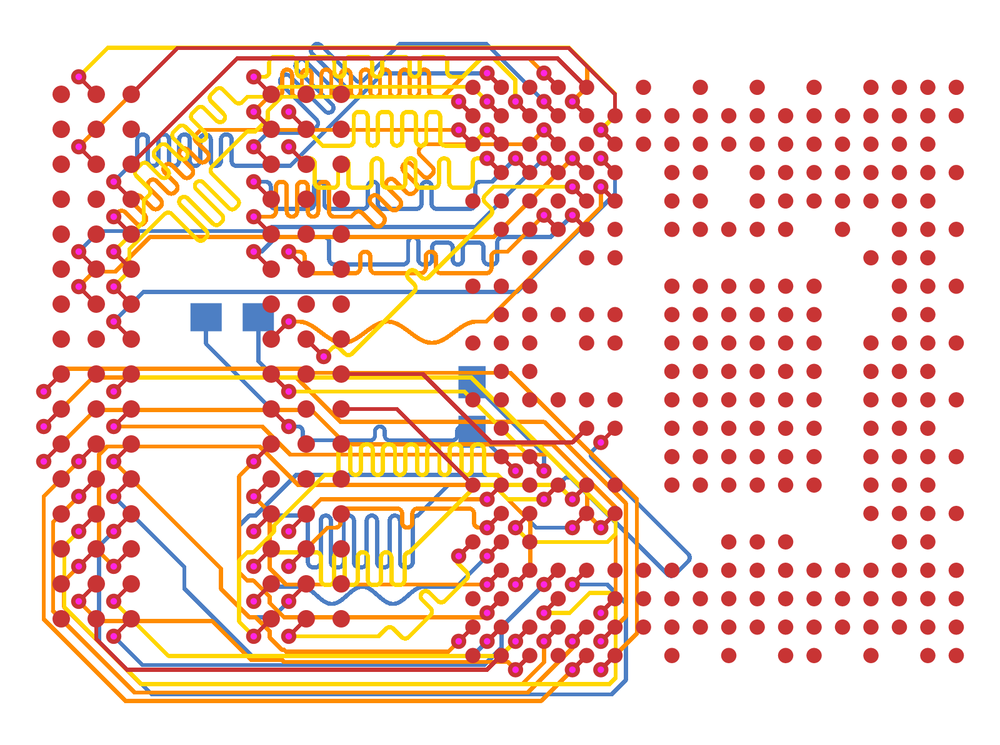

All eleven AM3352 cases passed fresh paired Blacksmith solves. Base/head validation metrics and iteration counts are identical; see comparison.md and comparison.json. The following snapshots were generated from separate fresh local final-head solves after all eleven passed connectivity, DRC, matching/coupling and immutable-power-copper validation. No failed or intermediate routing is shown.

## above

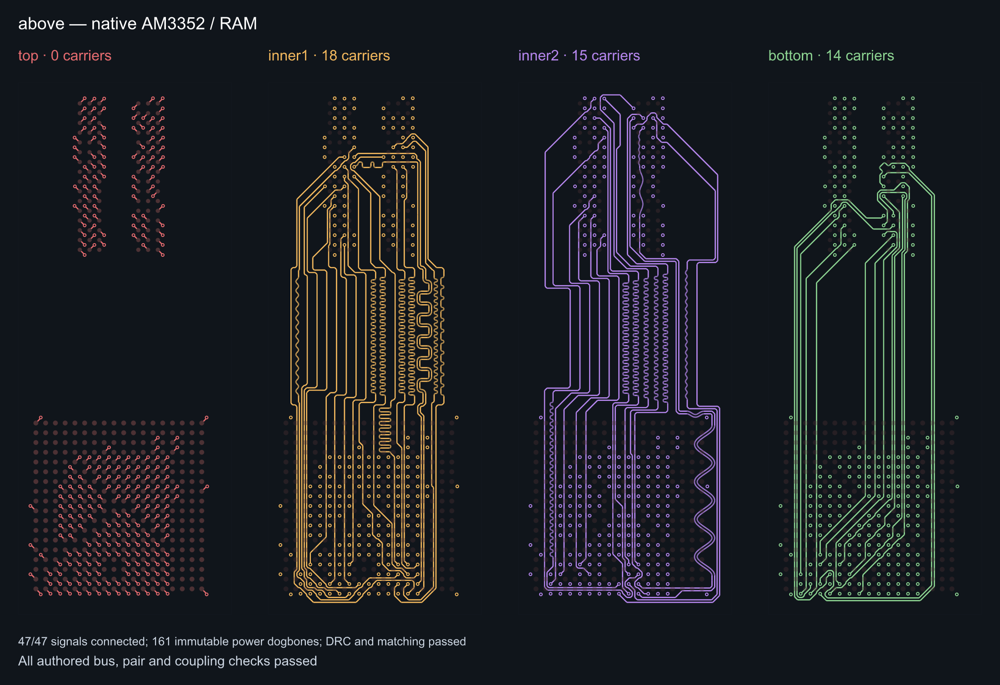

## control-inner1

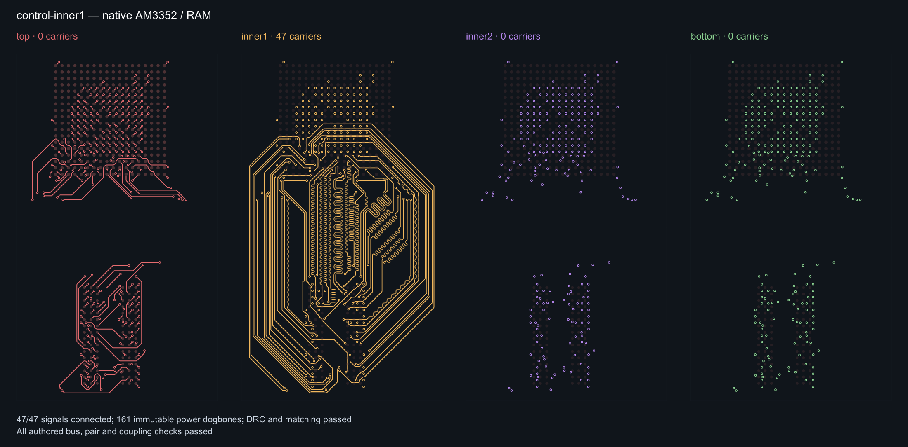

## control

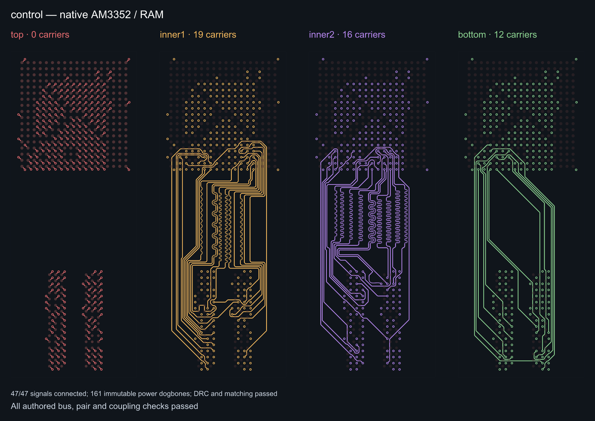

## inner-layers-above

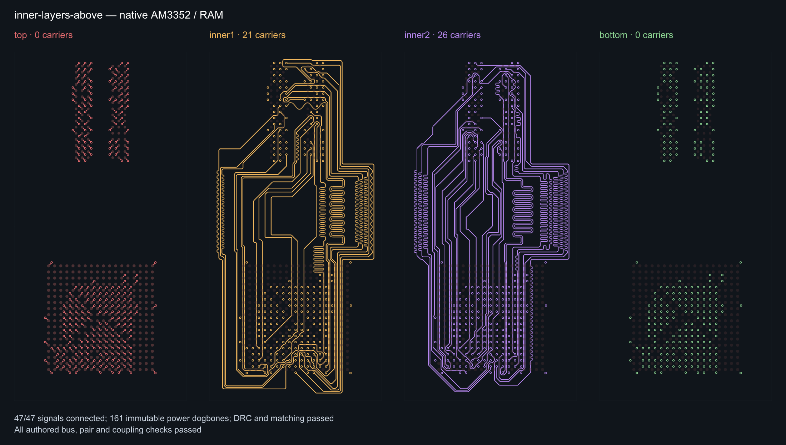

## inner-layers-complete-ca

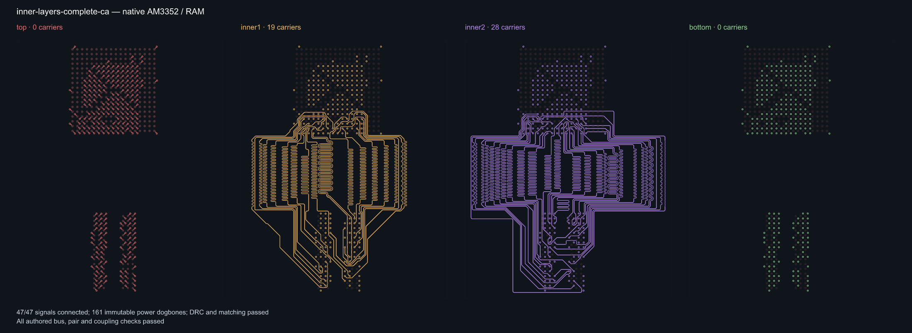

## inner-layers-left

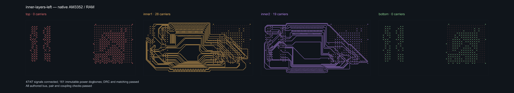

## inner-layers-right

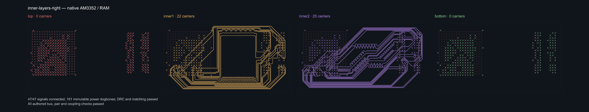

## inner-layers

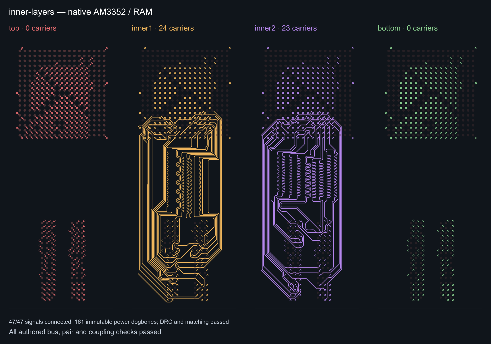

## left

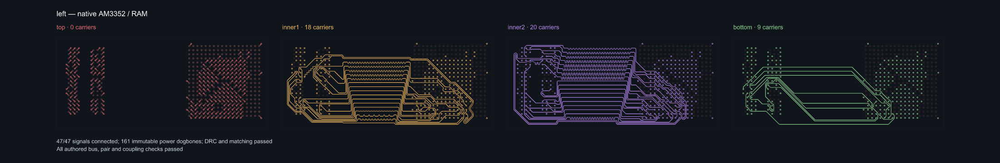

## outer-layers

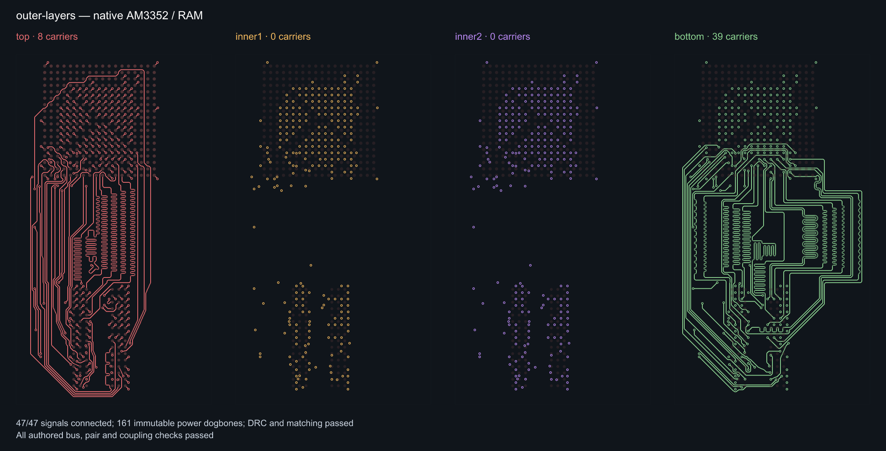

## right

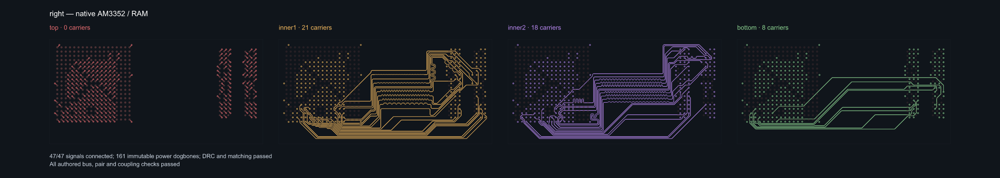

