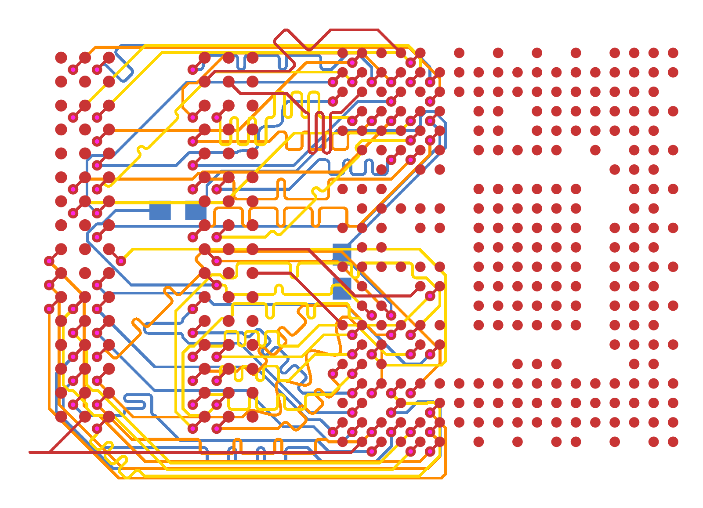
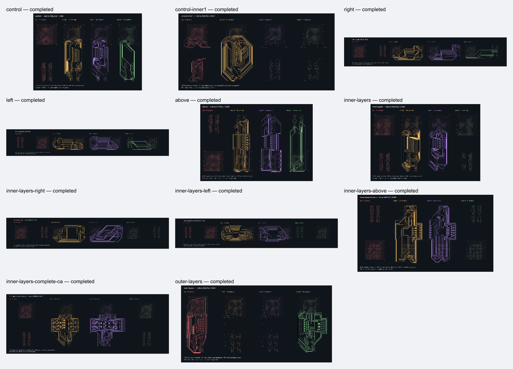

The combined H616 fix is `bb22465eee9ac2c014a4afd9fe2f2421d0ca2eec`, one commit above repro `50e1d0e779e3bb7766dd04677cdee9bcfc440712`; the repro is one commit above main `69e2159483e062013728cd8ff256f9343224a90b`. No PR is merged.

The fresh normal-Core run uses the built `dist/index.js` package through Core's existing native worker. Routing and matching share 120 seconds. It starts with no copper and finishes 53/53 signals, all nine hard skew checks and all six preservation checks, with zero physical DRC findings or geometry changes. Total local routing/matching wall time is 56.4 seconds on macOS arm64, Bun 1.4.2. This is not a speed comparison with Linux CI. Source and dependency pins are in [provenance.json](provenance.json); the unmodified native output is [h616-circuit.json.gz](h616-circuit.json.gz), with [measurements](h616.json).

| Original rule | Actual mm | Limit mm | Result |
| --- | ---: | ---: | --- |
| ADDR_LEN | 6.350000 | 6.35 | met |
| L_BYTE_LANE_LEN | 2.540000 | 2.54 | met |
| H_BYTE_LANE_LEN | 2.418145 | 2.54 | met |
| U2 byte0 DQ/DM to DQS (original matching) | 3.683061 | 7.546898 | met |
| U2 DQS0 pair (original matching) | 0.359684 | 0.359685 | met |
| U2 byte1 DQ/DM to DQS (original matching) | 5.381748 | 5.381748 | met |
| U2 DQS1 pair (original matching) | 0.427305 | 2.615682 | met |
| U2 clock pair (original matching) | 0.096628 | 0.096629 | met |
| U2 address/command to CK (original matching) | 13.375053 | 15.907342 | met |

Mean rules measure the greatest deviation from the actual class mean; reference rules compare each subject with every specified reference; pair rules measure the selected controller-to-memory path, excluding termination branches. Original rule memberships, limits, widths, placement, clearance and via-in-pad restrictions are unchanged. The independent native regression also checks these rules from empty copper.

The unfiltered [additional checker output](extra-verifications.json) retains the same three general unverified-geometry warnings as the earlier implementation. Its broad `passed` flag therefore remains false. Those warnings are deferred by the user; all physical finding categories are zero, and the independent hard-skew assessment passes. No warning suppression is included in the production fix.

The eleven AM3352 images below were regenerated from separate fresh solves of the final consolidated code, with a 3,600-second per-case budget and four local worker processes. Every output passed connectivity, DRC, matching/coupling and preservation of the 161 fixed power dogbones before rendering. Every individual image was inspected. All twelve PNGs, including the contact sheet, are byte-identical to the earlier reviewed gallery. See [validation summary](gallery-validation.json) and [complete validation reports](gallery-validation-full.json.gz). This is fresh solving, not saved-route revalidation.

- [control](am3352/control.png)
- [control-inner1](am3352/control-inner1.png)
- [right](am3352/right.png)
- [left](am3352/left.png)
- [above](am3352/above.png)
- [inner-layers](am3352/inner-layers.png)
- [inner-layers-right](am3352/inner-layers-right.png)
- [inner-layers-left](am3352/inner-layers-left.png)
- [inner-layers-above](am3352/inner-layers-above.png)
- [inner-layers-complete-ca](am3352/inner-layers-complete-ca.png)
- [outer-layers](am3352/outer-layers.png)

Final-revision paired Blacksmith reports are retained in the linked workflow artifacts. Every pair uses Bun 1.4.0, Linux x64 on a Blacksmith 4-vCPU runner, a pinned base harness, identical fixtures and a 3,600-second per-solver/sample budget.

- [Repro/main comparison](https://github.com/tscircuit/bus-lanes-solver/actions/runs/45563262527): main `69e2159` against repro `50e1d0e`.
- [Combined fix comparison](https://github.com/tscircuit/bus-lanes-solver/actions/runs/45562507619): repro `50e1d0e` against fix `bb22465`.

To reproduce the native checks in the solver checkout, install dependencies, run `bun run test:package`, and run `bun test tests/h616-reference-skew.test.ts tests/h616-completed-clock-reference.test.ts tests/mean-reference-skew.test.ts`. The paired CI command is `bun base/scripts/pr-benchmark/run-pair.ts --sample SAMPLE --timeout-seconds 3600 --main base/lib/index.ts --pr head/lib/index.ts --main-sha BASE_SHA --pr-sha HEAD_SHA --controller-sha BASE_SHA --output results/SAMPLE.json`, for every sample in the base revision's `scripts/pr-benchmark/samples.json`. It invokes the same worker as `./benchmark.sh --worker SAMPLE --solver SOLVER_PATH --timeout-seconds 3600`. Fresh local gallery captures additionally pass `--routes-directory DIR`.

For the normal-Core comparison, use the source/dependency pins in provenance, bind the built solver package as Core's `@tscircuit/bus-lanes-solver` dependency, then run `bun BENCHMARK/scripts/run.ts --core CORE --circuit h616 --timeout 120 --out NEW_OUTPUT_DIRECTORY`. The benchmark uses the public Core circuit and native routing pipeline; no custom autorouter adapter is involved.

Scope is the original 53-net DDR fixture. The separate 121-net whole-board reproduction is not timing-qualified.
